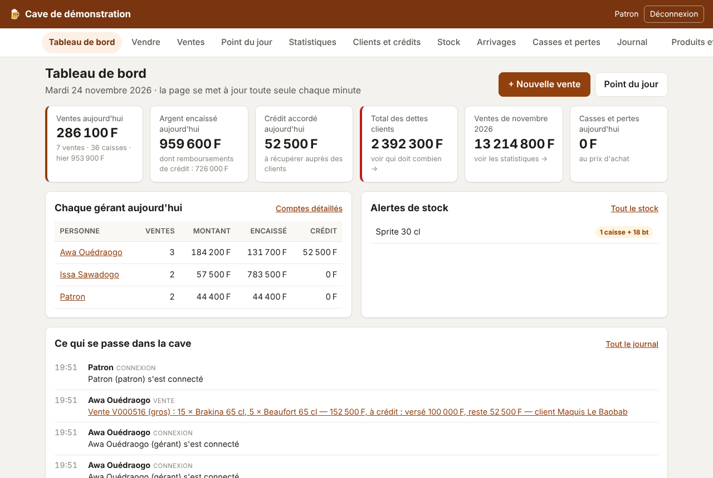
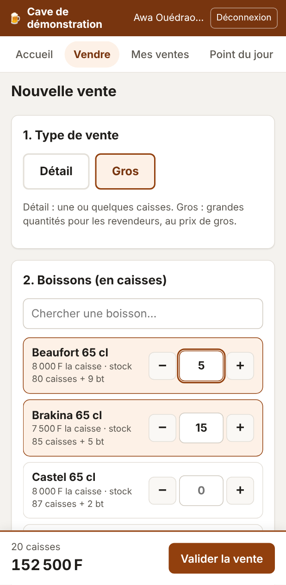
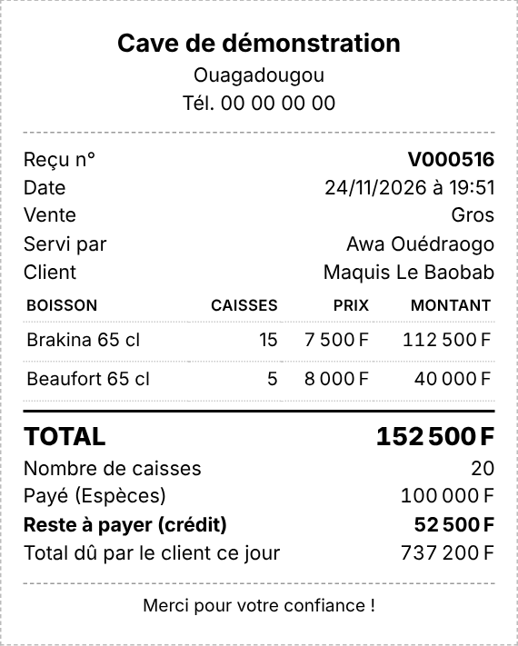
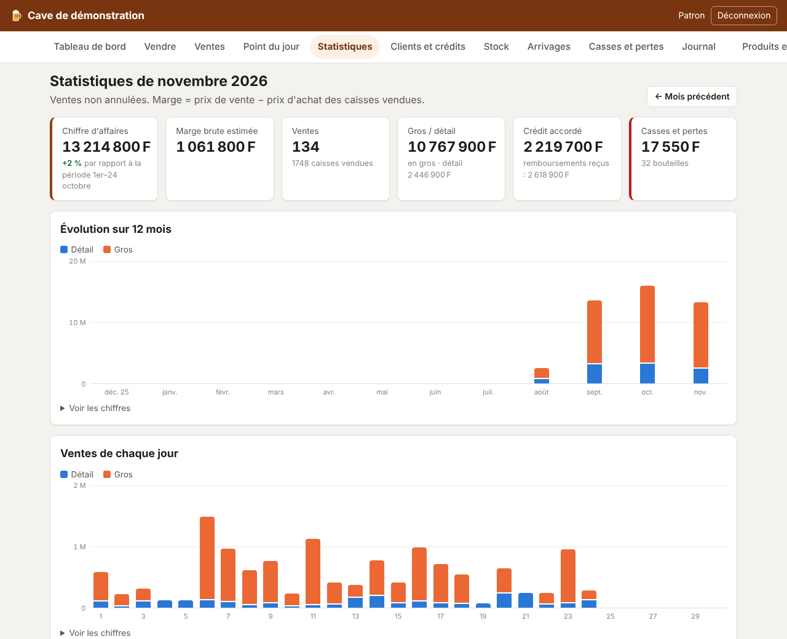

# Gestion de cave

Application web pour gérer une cave (dépôt de boissons) : ventes au **détail** et en **gros**
par caisse, **reçus** imprimables, **crédits** des clients, **stock**, **casses**, **comptes de fin
de journée** et **statistiques** du mois. Le **patron** suit tout à distance ; chaque **gérant** a
son compte.

- Ce que fait l'application et pourquoi : [`CAHIER_DES_CHARGES.md`](CAHIER_DES_CHARGES.md)
- La mettre en ligne gratuitement : [`HEBERGEMENT.md`](HEBERGEMENT.md)

| Tableau de bord du patron | Vente sur téléphone | Reçu |
|---|---|---|
|  |  |  |



## Les pages

| Page | Patron | Gérant | Rôle |
|---|:-:|:-:|---|
| Tableau de bord / Accueil | ✔ | ✔ | Patron : chiffres du jour, chaque gérant, dettes, alertes, dernières opérations (mise à jour chaque minute). Gérant : gros boutons et ses chiffres du jour. |
| Vendre | ✔ | ✔ | Détail ou gros, plusieurs boissons, comptant ou crédit (total ou partiel), espèces / Orange Money / Moov Money. Puis le reçu. |
| Ventes | toutes | les siennes | Liste par jour, reçus, annulation (patron). |
| Point du jour | toute la cave ou un gérant | sa caisse | Les comptes de fin de soirée, imprimables. |
| Statistiques | ✔ | — | Mois par mois : chiffre d'affaires, marge, détail / gros, évolution sur 12 mois, ventes par jour, par boisson, par gérant. |
| Clients et crédits | ✔ | ✔ | Qui doit combien, historique, remboursements avec reçu. |
| Stock | ✔ (+ valeur et besoins) | ✔ | Stock en caisses + bouteilles, alertes, ce qu'il faut commander pour 30 jours. |
| Arrivages | ✔ | ✔ | Caisses reçues du fournisseur (et stock de départ). |
| Casses et pertes | ✔ | ✔ | Bouteilles cassées, caisses disparues, produits avariés. |
| Journal | ✔ | — | Tout ce qui a été fait, par qui, à quelle heure (y compris connexions et mots de passe refusés). |
| Produits et prix, Gérants, Paramètres | ✔ | — | Boissons et prix, comptes des gérants, nom et adresse imprimés sur les reçus. |

## Essayer en ligne

Voir [`HEBERGEMENT.md`](HEBERGEMENT.md) : avec Render (gratuit), le dépôt suffit, aucune
installation. Par défaut, des **données de démonstration** sont chargées : 10 boissons, 2 gérants
(`awa`, `issa`, sans mot de passe tant que le patron ne leur en donne pas), 6 clients et environ
trois mois de ventes. **Noms et prix sont fictifs.**

## Lancer sur un PC

Il faut **Python 3.10 ou plus récent** et, sous Windows, **Git Bash**.

```bash
cp .env.exemple .env          # facultatif : mot de passe du patron, nom de la cave, démonstration
bash lancer-en-local.sh
```

Le script crée un environnement Python (`.venv`), installe les dépendances, prépare la base
(fichier `cave.sqlite3`), demande le mot de passe du patron au premier lancement, puis démarre
l'application sur <http://localhost:8000>. Les téléphones du même Wi-Fi l'ouvrent avec l'adresse
IP du PC : `http://192.168.x.x:8000`.

Pour lancer les tests :

```bash
. .venv/bin/activate           # sous Windows : . .venv/Scripts/activate
python manage.py test
```

## Comment c'est construit

Une application **Django** classique, rendue côté serveur : pas de framework JavaScript, un seul
fichier CSS et un petit fichier JavaScript de confort (boutons + / −, total en direct, bulles des
graphiques). Tout fonctionne aussi sans JavaScript, car le serveur refait tous les calculs.

```
config/settings.py      réglages (local : SQLite ; en ligne : PostgreSQL, HTTPS)
cave/models.py          les tables : produits, ventes, arrivages, pertes, clients, règlements, journal
cave/services.py        LES RÈGLES DE GESTION : vente, crédit, stock, comptes du jour, statistiques
cave/views.py           les pages : lisent la requête, appellent services.py, affichent
cave/droits.py          « réservé au patron »
cave/templates/cave/    le HTML des pages
cave/static/cave/       style.css et app.js
cave/tests.py           30 tests automatiques
cave/management/commands/
    initialiser_cave.py  crée le compte patron au premier déploiement
    charger_demo.py      données de démonstration
build.sh, render.yaml   construction et hébergement sur Render
```

Trois idées à retenir pour expliquer le code :

1. **Le stock se calcule, il ne se tape pas** : `stock = arrivages − ventes − pertes`
   (`services.stock_par_produit`). Il ne peut donc pas être faux par oubli de mise à jour, et
   annuler une vente remet automatiquement les caisses en stock.
2. **Chaque opération passe par une fonction de `services.py`** qui vérifie les règles, enregistre
   tout en une transaction (tout ou rien) et écrit une ligne dans le journal du patron.
3. **Rien ne s'efface** : une erreur se corrige par une annulation (patron seulement, motif
   obligatoire) qui reste visible.

### Sécurité

- Mots de passe **hachés** par Django (PBKDF2), jamais stockés en clair ; règles de mot de passe
  de Django (longueur, mots courants, ressemblance avec l'identifiant).
- Chaque page exige d'être connecté ; les pages du patron renvoient « Accès refusé » à un gérant ;
  un gérant ne peut pas ouvrir les reçus d'un autre.
- Formulaires protégés contre la falsification de requête (jeton **CSRF** de Django).
- En ligne : HTTPS (fourni par l'hébergeur), cookies réservés au HTTPS, session de 12 heures.
- Aucun secret dans le dépôt : `SECRET_KEY` et le mot de passe du patron viennent des variables
  d'environnement (`.env` est ignoré par Git).

## Technologies et licences

| Composant | Rôle | Licence | Projet |
|---|---|---|---|
| Python 3 | Langage | PSF | <https://www.python.org> |
| Django 5.2 (LTS) | Framework web | BSD-3-Clause | <https://www.djangoproject.com> |
| gunicorn | Serveur web en production | MIT | <https://gunicorn.org> |
| WhiteNoise | Sert le CSS et le JavaScript en production | MIT | <https://whitenoise.readthedocs.io> |
| dj-database-url | Lit l'adresse de la base (`DATABASE_URL`) | BSD-3-Clause | <https://github.com/jazzband/dj-database-url> |
| psycopg 3 | Connexion à PostgreSQL | LGPL-3.0 | <https://www.psycopg.org> |
| PostgreSQL | Base de données en ligne | PostgreSQL License | <https://www.postgresql.org> |
| SQLite | Base de données sur PC | Domaine public | <https://www.sqlite.org> |

Aucune police, bibliothèque ni image n'est chargée depuis Internet : l'application fonctionne
aussi sur un réseau local sans connexion.

Licence du code de l'application : à choisir par l'équipe (le dépôt est privé).
